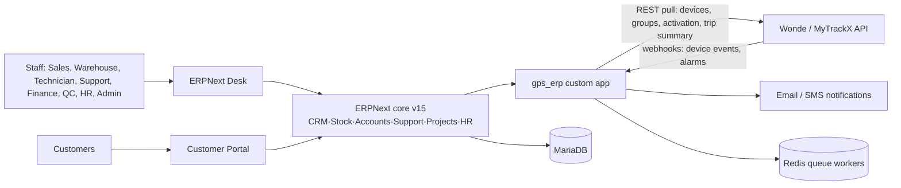
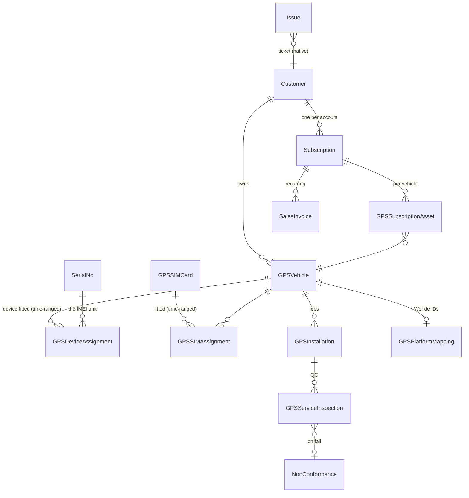

# GPS Tracking ERP — Technical Architecture Design
**App:** `gps_erp` · **Base:** ERPNext/Frappe v15 (stable) · **Integration:** Wonde/MyTrackX · **Date:** 2026-10-25
**Rule zero:** ERPNext/Frappe core is never edited. All custom objects live in `gps_erp`, module **GPS Tracking**.

---

## 1. System context

Raw telemetry stays in the GPS platform; the ERP stores **status and summaries only**.

## 2. Workspace map (24 planned → where they come from)
| Workspace | Source |
|---|---|
| Dashboard, Analytics | custom Workspace links + Report Dashboards |
| CRM, Stock, Projects, ToDo, Accounting, Procurement, HR & Payroll, Helpdesk | native ERPNext workspaces (role-restricted) |
| Fleet Register, GPS Devices, SIM Management, Installations, Billing & Subscription, Quality, Contracts | custom workspaces over gps_erp doctypes |
| My Claims, Performance Evaluation | native (Expense Claim, Appraisal) |
| Scheduling & Dispatch | custom (Installation calendar view) |
| Customer Portal, Administration | portal + standard Website/User settings |

## 3. Data model — core ERD

## 4. DocType specifications (fields: name · type · reqd/unique · notes)

### GPS Vehicle — autoname `field:license_plate`, not submittable
| Field | Type | Flag |
|---|---|---|
| license_plate | Data | reqd, unique, in_list_view |
| vin_chassis | Data | unique |
| customer | Link Customer | reqd, in_list_view, in_standard_filter |
| make / model / color | Data | |
| vehicle_type | Select: Car·Truck·Bus·Motorcycle·Heavy Equipment | default Car |
| status | Select: Active·In Maintenance·Returned·Terminated | default Active, reqd |
| purchase_date, odometer_km | Date, Int | |
| photo | Attach Image | |
| notes | Long Text | |

### GPS SIM Card — autoname `field:iccid`
| Field | Type | Flag |
|---|---|---|
| iccid | Data | reqd, unique (19–20 digits validated) |
| msisdn | Data | reqd, unique |
| provider | Link Supplier | reqd |
| data_plan | Data; monthly_cost Currency | |
| status | Select: In Stock·Active·Suspended·Expired·Replaced·Retired | default In Stock |
| activation_date / expiry_date | Date | expiry drives renewal alerts |

### GPS Device Assignment — `GPS-ASSIGN-.YYYY.-.####`, **submittable**
| Field | Type | Flag |
|---|---|---|
| serial_no | Link Serial No | reqd — the IMEI; item must be GPS-type |
| vehicle | Link GPS Vehicle | reqd |
| customer | Link Customer | fetch_from vehicle |
| technician | Link User | |
| start_date / end_date | Datetime | reqd start |
| status | Select: Active·Replaced·Returned | driven by submit/cancel + end_date |
Validation: overlap check (below) + IMEI belongs to stock.

### GPS SIM Assignment — `GPS-SIMA-.YYYY.-.####`
sim_card · device(serial_no) · vehicle · start/end Datetime · status. Same overlap rule.

### GPS Installation — `GPS-INST-.YYYY.-.####`, **submittable**, workflow
| Field | Type |
|---|---|
| vehicle, serial_no, sim_card | Links, reqd vehicle |
| technician | Link User, reqd |
| scheduled_date / completed_date | Date, Datetime |
| checklist | Table → GPS Checklist Item (item, result Select Pass/Fail/NA, remarks) |
| photos | Attach Image ×3 slots (photo_1..3) — keeps schema simple on v15 |
| customer_signature | Attach Image |
| platform_activation_verified | Check + verify_date |
| qc_status | Select: Awaiting QC·Passed·Failed (set only by Inspection, `frappe.only_for("Quality Manager")`) |

### GPS Service Inspection — `GPS-QC-.YYYY.-.####`, **submittable**
installation Link reqd · inspector · result Select Pass/Fail · remarks · non_conformance Link (auto-created on Fail via `quality_management` template pattern).

### GPS Subscription Asset — child table (attached to Subscription by Custom Field fixture)
vehicle · item_code · qty · rate · effective_from · effective_to · prorate Check.

### GPS Platform Settings — **Single**
base_url · api_key **Password** · api_secret **Password** · webhook_secret **Password** · enable_sync Check · last_sync Datetime · timeout_secs Int default 30.

### GPS Platform Mapping — `GPS-MAP-.####`
gps_vehicle (unique) · platform_device_id · platform_group_id · platform_account_ref · activation_status · last_seen Datetime.

### GPS Integration Log — `GPS-LOG-.YYYY.-.####`
direction Select Push/Pull/Webhook · endpoint · request_id Data (indexed, idempotency) · status Success/Failed/Pending · error Long Text · retry_count Int · payload Long Text (secrets stripped, truncated 4KB).

### GPS Firmware History — `GPS-FW-.YYYY.-.####`
serial_no · from_version · to_version · update_date · result · technician.

Reused native (no code): Customer, Lead, Opportunity, Quotation, **Contract**, Item, **Serial No**, Warehouse, Stock Entry, Purchase Order, **Issue + SLA**, Project/Task, Expense Claim, Appraisal, **Non Conformance**, **Subscription + Subscription Plan**, Sales Invoice, Payment Entry.

## 5. Key invariants (server-side, in controller `validate`/`before_submit`)
1. **No overlapping active assignments** — for same serial_no OR same vehicle where `docstatus < 2`, `name != current`, and date ranges intersect (`start_date <= COALESCE(end_date, now) AND COALESCE(end, now) >= start_date`) → `ValidationError` naming the conflicting doc. Uniqueness of *active* cannot be a plain DB index; enforced in code + weekly audit report (defense in depth).
2. IMEI and ICCID globally unique (DocType `unique` + case-normalized).
3. Submitted Assignment/Installation is immutable; changes require cancel (permission-restricted) + amend.
4. `qc_status=Passed` only settable by inspectors; `platform_activation_verified` required before first invoice for a vehicle.
5. Device replacement = workflow action: close old assignment (`end_date`), submit new — one transactional method, `frappe.only_for("GPS Fleet Manager")`.

## 6. RBAC matrix (summary; row-level rules appended)
| Doctype | Fleet Manager | Technician | Support Agent | Finance | QC | SysMgr |
|---|---|---|---|---|---|---|
| GPS Vehicle | CRUD | R | R | R | R | all |
| Device/SIM Assignment | CRD + submit | R + create own | R | – | R | all |
| GPS Installation | CRD submit | CRUD own rows¹ | R | – | R + cancel-fail | all |
| Service Inspection | R | – | – | – | CR submit | all |
| Platform Settings / Logs | R / CR | – | R | – | – | all |
| Subscription Asset edits | – | – | – | CRD submit | – | all |
¹ `permission_query_conditions`: `technician = % (user)s` on Installation/Assignment. Portal Customer: `has_website_permission` via vehicle→customer link (mirrors `controllers/website_list_for_contact.py`).

## 7. Billing architecture (per correction #4 — stronger idempotency)
- One `Subscription` per Customer (native engine: proration, VAT, terms — not forked).
- `GPS Subscription Asset` rows define per-vehicle lines; nightly job `sync_subscription_assets` adjusts rows from Active assignments.
- Invoice generation: native `create_recurring_invoice` extended to add one item line per asset row.
- **Triple idempotency:** ① `frappe.enqueue(job_name="bill-{sub}-{period_end}")` ② existence check `Sales Invoice` where `subscription=& gps_invoice_key=` ③ **Custom field `gps_invoice_key` on Sales Invoice with `unique: 1` + `db_index`** — DB-level guarantee that even concurrent workers cannot double-bill a period.
- Suspension/termination changes are draft→approved via Workflow (finance gate, per master plan §10).

## 8. Integration architecture (Wonde/MyTrackX — endpoints to be CONFIRMED, correction #3)
| Function | Method | Cadence | Idempotency |
|---|---|---|---|
| Sync device list / groups | GET pull | daily enqueue, queue=long, retry=3 | upsert by platform_device_id |
| Activation & comm status | GET pull | hourly for mapped vehicles | overwrite last_seen/status |
| Trip/summary counts (day) | GET pull | daily | unique (mapping, date) |
| Device events / alarms | webhook POST `/api/method/gps_erp.gps_tracking.integration.webhook.receive` | push | `request_id` unique in Integration Log |
Webhook security: HMAC-SHA256 header vs `webhook_secret` (`hmac.compare_digest`), constant-time; 200-fast then enqueue processing; unknown doctype payloads logged & dropped. Failure policy: log → 3 retries w/ backoff → "Integration error" notification to System Admin. **Open item:** sandbox credentials + endpoint/auth verification spike before Phase 6 development.

## 9. Customer portal
Pages (List view + detail, website-enabled): My Vehicles (status, device, SIM expiry), My Tickets (native Issue web form), My Invoices (native), Installation requests (Web Form `request-installation` → creates draft Installation). Access: portal User with Customer link; row-scope rule #6.

## 10. Reports (built as Query/Script Reports in-app)
Revenue Assurance (active-unbilled · billed-terminated · platform-count delta) · ERP↔Wonde reconciliation · Fleet/device utilization · SIM expiring ≤30d · Device aging & warranty · Installation SLA compliance · Technician productivity (for Appraisals) · Receivables aging (native).

## 11. Delivery engineering
- **Git:** app repo `gps-erp` (separate from the read-only `Erp-System` snapshot); `main` protected; one branch per feature (`feat/vehicle-master`, `feat/assignments`…); every merge via PR with Codex review + `bench run-tests --app gps_erp` green; no force-push (corrections #5, #6).
- **Config-as-code:** Roles, Workflows, Custom Fields, Workspaces, Web Forms shipped as `fixtures/` in git — environments reproducible.
- **Testing:** unit per doctype validation (overlap, uniqueness), billing double-run test, webhook replay test, row-security test with 3 persona users.
- **Environments:** dev.local (WSL2) → staging (Linux VM) → prod; backups nightly + restore drill per master plan §13.

## 12. Phase gate status
Phase 0 **blocked** pending Windows restart + first Ubuntu launch (last boot 18 Oct). Architecture design (this doc) is approved scope input; no module code until Phase 0 verified green.
